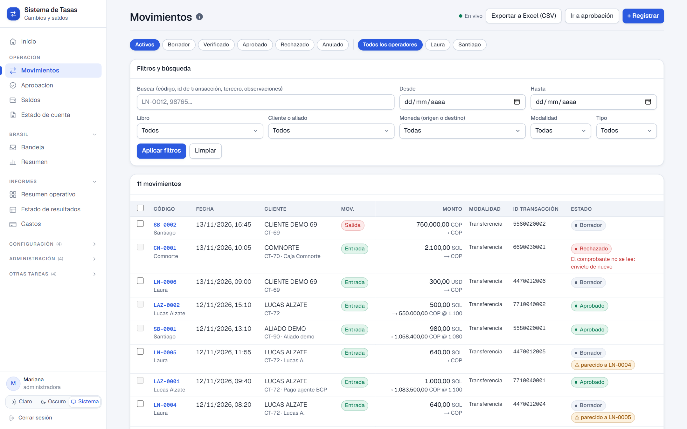
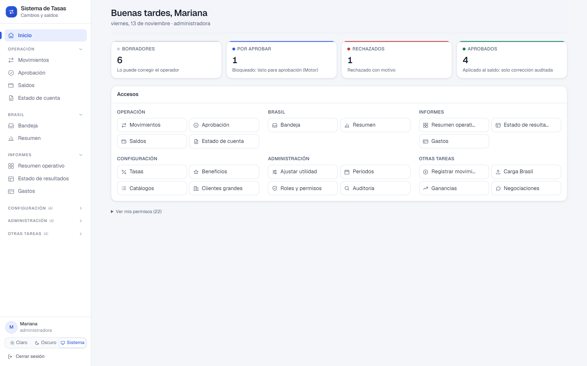
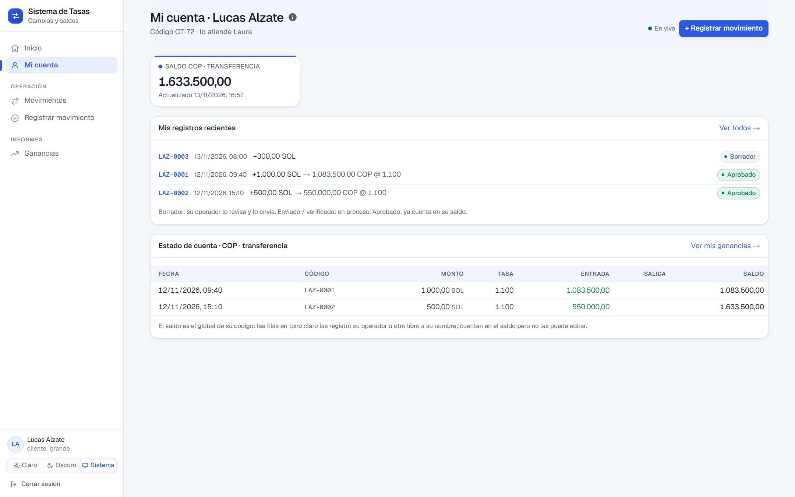
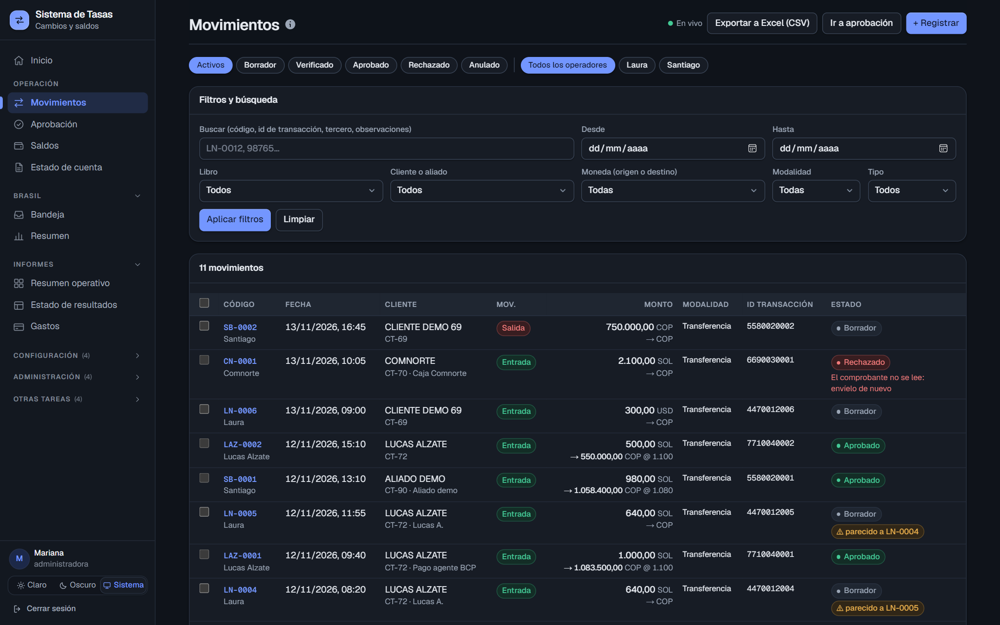
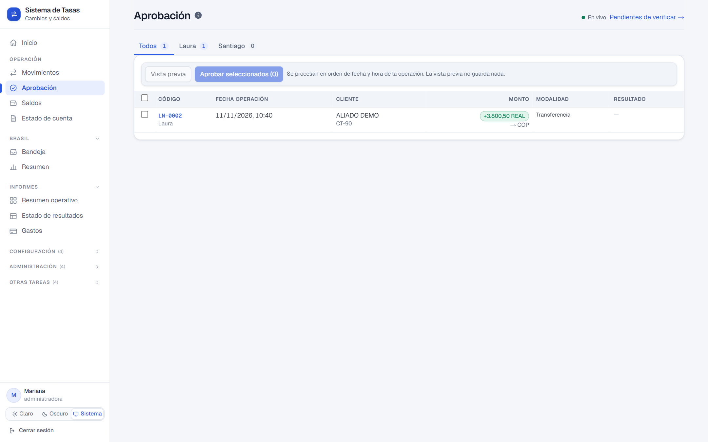
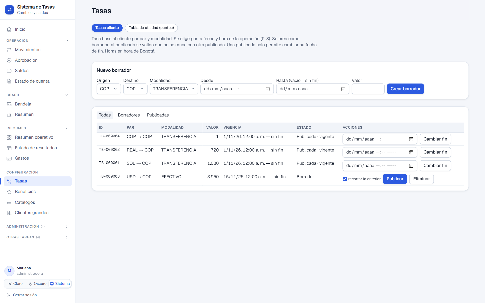
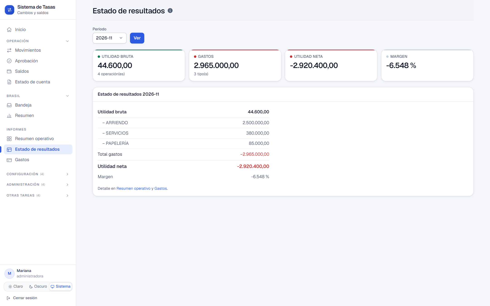
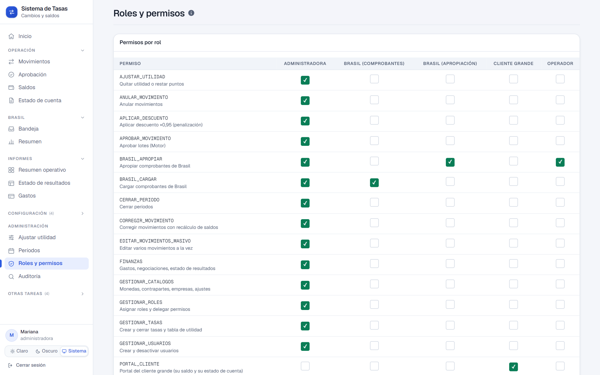
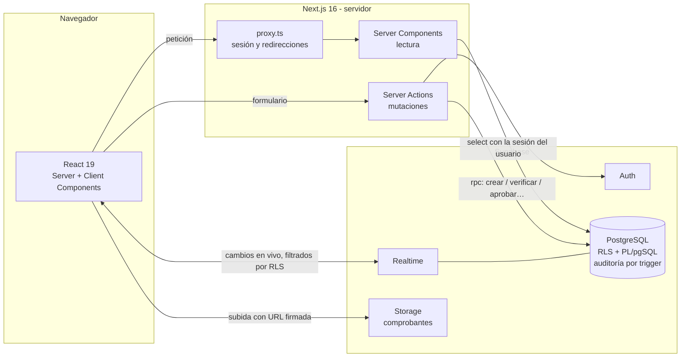
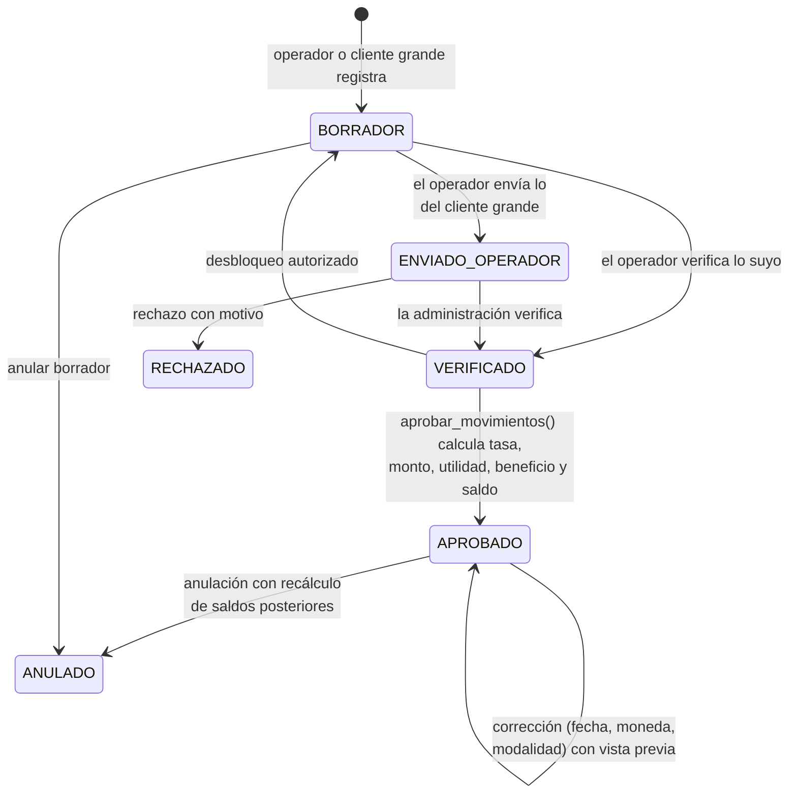

# 💱 Sistema de Tasas de Cambio — Plataforma web

**Migración de una operación cambiaria real desde Google Sheets + Apps Script a una aplicación web con Next.js y Supabase (PostgreSQL).**


> [!NOTE]
> **Esta es la versión demo pública del proyecto.** Todo el código es el del sistema real, pero **los datos son ficticios**:
> los nombres de personas, clientes, libros y cuentas bancarias fueron reemplazados por nombres inventados, y la base
> se llena con datos de ejemplo (`supabase/seed.sql`). No contiene datos, credenciales ni configuración de producción.

---

## 🇬🇧 English summary

A currency-exchange business ran its daily operation on **~16 interconnected Google Sheets** (operators, large clients,
a Brazil desk and a "mother" ledger), glued together with Apps Script and HTTP calls between workbooks. It was slow,
balances drifted out of sync and any user could overwrite history.

I designed and built its replacement: a **Next.js 16 + Supabase** web app where every "send between workbooks" becomes a
**state change on a single PostgreSQL row**. Business rules live in the database (PL/pgSQL functions called via RPC),
authorization is enforced with **Row Level Security**, every table is **audited by trigger**, money is stored as exact
`numeric`, exchange rates have non-overlapping validity ranges (`EXCLUDE USING gist` on `tstzrange`), and approving a
batch is **one atomic transaction** that locks only the affected balance buckets. The legacy history is migrated with
idempotent ETL scripts and validated with **"golden tests"** that recompute every historical transaction and compare it
with what the spreadsheets stored. Covered by **pgTAP** database tests, unit tests, smoke and end-to-end scripts, and CI.

---

## Índice

1. [El problema](#-el-problema)
2. [La solución](#-la-solución)
3. [Capturas](#-capturas)
4. [Lo más destacado](#-lo-más-destacado)
5. [Tecnologías](#-tecnologías)
6. [Arquitectura](#-arquitectura)
7. [Ciclo de vida de un movimiento](#-ciclo-de-vida-de-un-movimiento)
8. [Módulos funcionales](#-módulos-funcionales)
9. [Roles y permisos](#-roles-y-permisos)
10. [Seguridad](#-seguridad)
11. [Dinero, tasas y concurrencia](#-dinero-tasas-y-concurrencia)
12. [Migración desde Google Sheets](#-migración-desde-google-sheets)
13. [Calidad y pruebas](#-calidad-y-pruebas)
14. [Cómo se trabajó](#-cómo-se-trabajó)
15. [Estructura del repositorio](#-estructura-del-repositorio)
16. [Correrlo en local](#-correrlo-en-local)

---

## 🧩 El problema

El negocio compra y vende divisas (COP, USD, SOL, REAL, USDT) a través de operadores, clientes grandes y una mesa en
Brasil. Toda la operación vivía en hojas de cálculo:

| Antes (Sheets + Apps Script) | Consecuencia |
|---|---|
| ~16 libros que se "envían" filas entre sí por HTTP (cliente → operador → libro madre) | Lentitud, envíos perdidos y una sincronización de respaldo para recuperar lo que no llegaba |
| Cada libro guardaba su propia copia de saldos | Saldos que no cuadraban entre libros |
| Una API key compartida por libro | Imposible saber **quién** hizo **qué** |
| Cualquiera con acceso podía editar una fila ya aprobada | Historial sin garantías ni auditoría |
| Cálculo de tasas, utilidad y saldos repartido en scripts | Reglas difíciles de mantener y de probar |

## ✅ La solución

**Una sola base de datos.** Lo que antes era un envío HTTP entre libros ahora es un **cambio de estado** de una fila:

| Antes | Ahora |
|---|---|
| El cliente envía al operador (POST) | `movimiento.estado = 'ENVIADO_OPERADOR'` |
| El operador verifica | `estado = 'VERIFICADO'` + quién y cuándo |
| El operador envía lote al libro madre | RPC `aprobar_movimientos(ids[])`: una transacción atómica |
| El libro madre notifica al cliente | El cliente ve el cambio al instante (Supabase Realtime) |
| Sincronización de respaldo | Ya no existe: no hay copias que se desincronicen |

Los códigos que el negocio ya conocía (`LN-0001`, `CN-0042`, `BRS-…`) se conservan como **código visible**, generado
sin carreras por la base de datos.

## 📸 Capturas

| Bandeja de movimientos (en vivo, con detección de duplicados) | Inicio de la administración |
|---|---|
|  |  |
| **Portal del cliente grande** | **Modo oscuro** |
|  |  |
| **Aprobación por lotes** | **Tasas con vigencia** |
|  |  |
| **Estado de resultados** | **Roles y permisos delegables** |
|  |  |

Más en [`docs/capturas/`](docs/capturas/). Todos los datos que se ven son de la demo.

## ⭐ Lo más destacado

- **Lógica de negocio en la base de datos:** ~95 funciones PL/pgSQL (crear, verificar, aprobar, rechazar, anular,
  corregir, recalcular saldos, cerrar períodos…). La interfaz no puede saltarse una regla porque la regla no vive en la interfaz.
- **Autorización real con RLS:** 50+ políticas de Row Level Security y un modelo de permisos finos
  (`tiene_permiso('APROBAR_MOVIMIENTO')`). La UI solo oculta lo que la base ya prohíbe.
- **Auditoría total:** un trigger genérico `auditar()` registra en cada tabla de negocio quién cambió qué, cuándo, el
  antes y el después. **Nada se borra: se anula.**
- **Dinero exacto:** `numeric` en todo el cálculo (nunca `float`); las tasas guardan todos sus decimales (se detectó y corrigió un redondeo heredado de hasta 0,125 % por conversión).
- **Tasas con vigencia sin solapes:** restricciones `EXCLUDE USING gist` sobre rangos `tstzrange`.
- **Concurrencia controlada:** aprobar un lote bloquea (`FOR UPDATE`) solo los *buckets* de saldo afectados; dos
  operadores que aprueban cosas distintas no se esperan.
- **Tiempo real:** las bandejas se actualizan solas con Supabase Realtime, que respeta la RLS de cada usuario.
- **Migración verificable:** ETL idempotente desde Sheets + **pruebas de oro** que recalculan cada movimiento histórico y
  lo comparan con el valor guardado en las hojas, + conciliación automática de saldos.
- **Pruebas en la base:** 23 suites **pgTAP** con 436 pruebas (permisos, RLS, auditoría, cálculo, consecutivos, Brasil…) que corren en CI
  sobre una base creada desde cero con todas las migraciones.

## 🛠 Tecnologías

| Capa | Tecnología | Para qué |
|---|---|---|
| Frontend | **Next.js 16** (App Router, Server Components, Server Actions), **React 19**, **TypeScript** | Páginas renderizadas en servidor; las mutaciones van por Server Actions → RPC |
| Estilos | **Tailwind CSS 4** + sistema de diseño propio (tokens, modo claro/oscuro) | Interfaz consistente, tablas densas tipo hoja de cálculo |
| Base de datos | **PostgreSQL 17** en **Supabase** | SQL real, transacciones, `numeric`, rangos, `EXCLUDE` |
| Lógica de negocio | **PL/pgSQL** (funciones `security definer`, triggers, vistas `security_invoker`) | Reglas atómicas y centralizadas |
| Autenticación | **Supabase Auth** (correo + contraseña, sesión por cookies con `@supabase/ssr`) | Usuarios reales en vez de API keys compartidas |
| Autorización | **Row Level Security** + tablas de roles/permisos | Cada quien ve y hace solo lo suyo |
| Tiempo real | **Supabase Realtime** (`postgres_changes`) | Bandejas que se actualizan solas |
| Archivos | **Supabase Storage** (bucket privado, URLs firmadas) | Comprobantes de pago de Brasil |
| Pruebas | **pgTAP**, `node:test`, scripts smoke y e2e en Node | Base, utilidades, pantallas y flujos completos |
| CI | **GitHub Actions** | Migraciones desde cero + pgTAP + pruebas unitarias + lint + build |
| Entorno local | **Supabase CLI + Docker** | Base idéntica a producción en el computador |
| Sistema anterior | Google Sheets + Apps Script (clasp) | Origen de la migración |

## 🏗 Arquitectura



**Principios:**

1. **La base de datos es la fuente de verdad y el guardián.** Toda escritura importante pasa por una función RPC que
   valida permisos, estado y reglas dentro de una transacción.
2. **El servidor de Next.js nunca usa la llave de servicio.** Consulta con la sesión del usuario, así que la RLS se aplica
   siempre, también en el servidor.
3. **Migraciones versionadas e inmutables.** Una migración ya aplicada no se edita: se crea otra (30 migraciones).
4. **Nada se borra.** Los movimientos se anulan con motivo; los catálogos se desactivan; todo queda auditado.

## 🔄 Ciclo de vida de un movimiento



Al **aprobar**, la función `calcular_movimiento()` busca la tasa cliente y la tabla de utilidad **vigentes en la fecha
del movimiento**, aplica el beneficio del cliente y los descuentos fijos del medio de pago, y actualiza el saldo del
*bucket* (contraparte × moneda × modalidad). Si el período del mes está cerrado, nada se puede cambiar.

## 🧭 Módulos funcionales

| Módulo | Ruta | Qué hace |
|---|---|---|
| Inicio | `/` | Resumen por estado de los movimientos visibles para el usuario |
| Movimientos | `/movimientos`, `/movimientos/nuevo`, `/movimientos/[id]` | Bandeja con filtros, paginación y exportar a Excel (CSV); registro con detección de posibles duplicados; detalle con historial |
| Aprobación | `/aprobacion` | Aprobación por lotes en el orden en que deben aplicarse |
| Saldos | `/saldos` | Saldo por cliente, moneda y modalidad; recalcular un bucket |
| Estado de cuenta | `/estado-cuenta` | Extracto por cliente y rango de fechas con saldo inicial y final |
| Portal del cliente | `/portal` | Lo que ve un cliente grande: sus saldos y movimientos |
| Ganancias | `/ganancias` | Caja de ganancias del cliente grande, retiros y liquidaciones |
| Brasil | `/brasil`, `/brasil/bandeja`, `/brasil/resumen` | Carga de comprobantes por banco (con archivo), bandeja de apropiación en vivo con toma/liberación, resumen diario y Binance |
| Tasas | `/tasas` | Tasas cliente y tabla de utilidad con vigencia, estados (modificable → cerrado) |
| Beneficios / Catálogos | `/beneficios`, `/catalogos` | Monedas, empresas, medios de pago, contrapartes, bancos, beneficios por cliente |
| Finanzas | `/finanzas/*` | Gastos, negociaciones, resumen operativo (utilidad mes × cliente × moneda) y estado de resultados |
| Administración | `/admin/*` | Ajustar utilidad, cierre/reapertura de períodos, roles y permisos delegables, clientes grandes, auditoría |

## 👥 Roles y permisos

| Rol | Puede |
|---|---|
| `superadmin` | Todo, incluidas herramientas de recálculo que nadie más puede tener |
| `administradora` | Aprobar, rechazar, corregir, tasas, reportes, finanzas y **delegar permisos** |
| `operador` | Registrar y verificar movimientos de sus libros y de los clientes grandes que atiende |
| `cliente_grande` | Registrar en su libro; ver solo sus saldos, ganancias y retiros |
| `brasil` | Cargar comprobantes y ver el resumen de bancos |
| `brasil_operador` | Apropiar comprobantes a un libro destino |

Los permisos son códigos (`APROBAR_MOVIMIENTO`, `FINANZAS`, `CERRAR_PERIODO`…) asignables por rol o delegables a una
persona. Los permisos `solo_superadmin` no se pueden asignar ni delegar: lo impide un trigger.

## 🔐 Seguridad

- **RLS en todas las tablas** de negocio, basada en funciones como `tiene_permiso()`, `puede_ver_libro()` y
  `es_mi_contraparte()`. Optimizada para no reevaluar en cada fila (migración `rls_rapido`).
- **Funciones `security definer` con `search_path` fijo** y `revoke execute` a `anon`/`authenticated` donde no aplica.
- **Vistas `security_invoker`** para que los reportes respeten la RLS de quien consulta.
- **Protección del superadmin:** solo un superadmin puede crear otro (trigger), y no se le puede quitar el rol desde la app.
- **Sin registro abierto en producción:** los usuarios se invitan; contraseña mínima de 10 caracteres.
- **Auditoría de seguridad** propia (migración `auditoria_seguridad`) con su suite pgTAP.
- **Semillas solo locales:** `seed.sql` nunca se envía a un entorno remoto.

## 💰 Dinero, tasas y concurrencia

- `numeric` exacto en montos, tasas, utilidad y saldos; los números del formulario se validan para rechazar formatos
  ambiguos (`1.234,5` vs `1,234.5`) — ver `src/lib/numeros.ts` y sus pruebas.
- **Vigencias:** cada tasa tiene un rango `tstzrange`; una restricción `EXCLUDE USING gist` impide dos tasas vigentes a la
  vez para el mismo par de monedas y modalidad. Una tasa `CERRADO` ya no se puede editar.
- **Saldos materializados:** `saldo_bucket` se actualiza dentro de la misma transacción que aprueba; consultar un saldo es
  leer una fila, no recorrer el historial.
- **Bloqueos mínimos:** `SELECT … FOR UPDATE` solo sobre los buckets afectados, en orden determinista para evitar *deadlocks*.
- **Consecutivos sin carreras:** `siguiente_codigo()` con `UPDATE … RETURNING` sobre una tabla de contadores.
- **Correcciones seguras:** cambiar fecha, moneda o modalidad de un aprobado muestra primero una **vista previa** de cómo
  quedan los saldos posteriores (incluido el primer saldo negativo, si lo hay) y luego aplica todo en una transacción.

## 🚚 Migración desde Google Sheets

La parte más delicada: pasar años de historial sin perder un peso.

1. **Exportación de solo lectura** desde Apps Script a JSON/CSV (el script no puede escribir en las hojas).
2. **Importadores idempotentes** (`scripts/importar-core.mjs`, `importar-historial.mjs`, `importar-brasil.mjs`): mapean
   columnas, normalizan textos y montos, conservan el código original y dejan **cada fila rechazada en un reporte con su
   motivo**. Se pueden repetir sin duplicar. Primero simulan; solo guardan con `--aplicar`.
3. **Pruebas de oro** (`scripts/pruebas-oro.mjs`): recalculan cada movimiento histórico con `calcular_movimiento()` y lo
   comparan con la tasa, monto, saldo y utilidad que guardó la hoja. Cada diferencia sale en un CSV.
4. **Conciliación de saldos** (`scripts/conciliar-saldos.mjs`): compara cada bucket contra el último saldo en Sheets.
5. **Ensayo completo** (`scripts/ensayo-migracion.sh`) en una base aparte, sin tocar la de desarrollo.

En este repositorio los archivos de `scripts/fixtures/` son **ejemplos inventados** para probar los importadores.

## 🧪 Calidad y pruebas

| Tipo | Dónde | Qué cubre |
|---|---|---|
| Base de datos (pgTAP) | `web/supabase/tests/` (23 suites, 436 pruebas) | Permisos, RLS, delegación, superadmin, auditoría, consecutivos, tasas y vigencias, movimientos, aprobación, rechazo/anulación, períodos, clientes grandes, saldos por operador, Brasil |
| Unitarias (`node:test`) | `web/scripts/*.test.mjs` | Parseo de números, paginación por lotes, CSV |
| Smoke | `web/scripts/smoke.mjs` | Inicia sesión con cada rol y recorre cada pantalla: código HTTP, redirecciones y texto esperado |
| End-to-end | `web/scripts/e2e-*.mjs` | Flujo de tasas, subida de comprobantes con URL firmada, notificaciones en tiempo real |
| CI | `.github/workflows/ci.yml` | Base desde cero con todas las migraciones → pgTAP → unitarias → lint → build |

## 🗂 Cómo se trabajó

- **Scrum con sprints cortos** y un *planner* de historias (`STW-n`). Cada historia tiene criterio de aceptación y
  evidencia; los comentarios del código y las migraciones citan la historia que los originó.
- **Descubrimiento antes de construir:** se clonó el sistema de Apps Script con `clasp`, se documentaron sus reglas
  (cálculo del libro madre, flujo cliente → operador → madre, Brasil) y se resolvió una lista de preguntas abiertas con
  el negocio antes de diseñar el modelo de datos.
- **Sprints entregados:**

  | Sprint | Entregable |
  |---|---|
  | 1 | Proyecto base, login, roles, permisos y auditoría |
  | 2 | Catálogos, tasas cliente, tabla de utilidad y beneficios con vigencia; importador del catálogo |
  | 3 | Brasil: comprobantes, bandeja y apropiación, resumen y Binance |
  | 4 | Registro y verificación de movimientos; sistema de diseño |
  | 5 | Motor de aprobación y pruebas de oro |
  | 6 | Rechazo, anulación, correcciones, períodos, estado de cuenta, reportes y finanzas |
  | 7 | Clientes grandes, ganancias y estado de resultados |
  | 8 | Retiros, migración del historial y conciliación |
  | 9 | Tiempo real, saldos por operador, rendimiento de RLS, auditoría de seguridad |

- **Entornos:** desarrollo 100 % local (Supabase en Docker, `db reset` sin miedo) y producción en Supabase Cloud.
  Las migraciones solo llegan a producción desde el repositorio (script o GitHub Actions con aprobación), nunca a mano.
- **El sistema viejo nunca se tocó en producción:** los parches se probaron en copias de las hojas.
- **Desarrollo asistido por IA** (Claude Code) con revisión humana de cada cambio.

## 📁 Estructura del repositorio

```
.
├── .github/workflows/ci.yml        # CI: migraciones + pgTAP + unitarias + lint + build
├── docs/
│   ├── DESPLIEGUE.md               # Cómo llevarlo a Supabase Cloud + Vercel
│   └── capturas/                   # Capturas de la demo
└── web/
    ├── src/
    │   ├── app/
    │   │   ├── (app)/              # Pantallas autenticadas (movimientos, aprobación, saldos, brasil, finanzas, admin…)
    │   │   └── login/              # Inicio de sesión
    │   ├── components/             # Sistema de diseño: tablas, formularios, navegación, tema, tiempo real
    │   ├── lib/                    # Números, fechas, CSV, paginación, menú por permisos, clientes Supabase
    │   └── proxy.ts                # Sesión y redirecciones (middleware de Next 16)
    ├── supabase/
    │   ├── migrations/             # 30 migraciones SQL versionadas (esquema, RLS, funciones, triggers)
    │   ├── tests/                  # Suites pgTAP
    │   └── seed.sql                # Usuarios y datos DEMO (solo local)
    └── scripts/                    # Importadores, pruebas de oro, conciliación, smoke, e2e, despliegue de migraciones
```

## ▶️ Descargar y correrlo en local

Todo corre en tu computador: la base de datos (Supabase) se levanta en Docker con los datos demo ya cargados. No
necesitas cuentas ni claves de ningún servicio.

### 1. Requisitos

| Programa | Versión | Descarga |
|---|---|---|
| Git | cualquiera reciente | https://git-scm.com/downloads |
| Node.js | 20 o superior | https://nodejs.org |
| Docker Desktop | encendido antes de empezar | https://www.docker.com/products/docker-desktop |

### 2. Descargar

```bash
git clone https://github.com/Jasnier/sistema-tasas-cambio-demo.git
cd sistema-tasas-cambio-demo/web
```

(O sin Git: botón verde **Code → Download ZIP**, descomprimir y abrir una terminal en la carpeta `web`.)

### 3. Instalar y arrancar

```bash
npm install                      # dependencias (1–2 min)
npm run db:start                 # Supabase en Docker: crea la base, aplica las 30 migraciones y carga los datos demo
                                 # (la primera vez descarga las imágenes de Docker: puede tardar varios minutos)
cp .env.example .env.local       # en Windows (PowerShell): copy .env.example .env.local
npm run dev
```

Abrir **http://localhost:3000** e iniciar sesión con cualquiera de los usuarios demo de abajo.

> Si `npx supabase status` muestra una `PUBLISHABLE_KEY` distinta a la de `.env.local`, cópiala ahí y reinicia `npm run dev`.
>
> Para apagar todo: `Ctrl + C` en la terminal de la app y luego `npm run db:stop`.

**Usuarios demo** (contraseña `Local123!` para todos):

| Correo | Rol | Qué ver |
|---|---|---|
| `superadmin@tasas.local` | superadmin | Todo el sistema |
| `admin@tasas.local` | administradora | Aprobación, saldos, finanzas, roles y auditoría |
| `laura@tasas.local` | operador | Bandeja de su libro y de los clientes que atiende |
| `santiago@tasas.local` | operador | Otro operador (no ve lo de Laura) |
| `comnorte@tasas.local` | cliente grande | Portal del cliente |
| `laz@tasas.local` | cliente grande con ganancias | Ganancias y retiros |
| `paula@tasas.local` | brasil | Carga de comprobantes y resumen |

**Pruebas:**

```bash
npm run db:test                  # pgTAP
npm run test:unit                # node:test
npm run lint
npm run build && npx next start -p 3100 &
npm run smoke -- http://localhost:3100
```

Supabase Studio local: http://127.0.0.1:54323

---

## 👤 Autor

**Jasnier Pérez** — análisis del sistema anterior, diseño del modelo de datos, desarrollo full-stack, migración y pruebas.

[GitHub](https://github.com/Jasnier)
